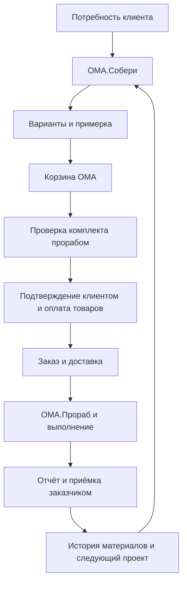

# ОМА от первой идеи до готового ремонта

Единая продуктовая спецификация ОМА.Собери и ОМА.Прораб. Версия 1.0 от 27 октября 2026 года.

Документ фиксирует согласованную концепцию и требования к будущей реализации. Программная реализация ещё не создана. Архитектура, API и технические критерии описаны в [техническом приложении](docs/technical-spec.md).

**ОМА.Собери помогает понять, что изменить, увидеть результат и подготовить покупку. ОМА.Прораб помогает подтвердить комплект перед оплатой, выбрать исполнение и сопровождать ремонт до приёмки заказчиком. Оба сервиса работают с одним проектом внутри экосистемы ОМА.**

## Навигация

- [Зафиксированные решения](#decisions).
- [Общий продукт и связь сервисов](#product).
- [Полный путь клиента](#journey).
- [ОМА.Собери](#soberi).
- [ОМА.Прораб](#prorab).
- [Проверка перед оплатой](#checkout).
- [Наглядное сопровождение ремонта](#tracking).
- [AI и данные](#ai).
- [Модель для ОМА и продвижение](#business).
- [Реализация и готовность](#delivery).
- [Сценарий презентации](#pitch).

## 1 Зафиксированные решения

| Вопрос | Решение |
|---|---|
| Пространство | Проект поддерживает комнату и квартиру с несколькими помещениями; объём определяется запросом клиента |
| Визуальная ценность | Пользователь видит предполагаемый результат при выборе, покупке и сопровождении выполнения |
| Интеграция ОМА | Создаётся демонстрационный магазин с каталогом, поиском, корзиной, заказом и доставкой; взаимодействие идёт через API |
| Прораб перед покупкой | Для сценария с исполнителем комплект подтверждается до оплаты; обращение готовится системой |
| Приёмка | Заказчик явно принимает работу либо направляет замечания прорабу |
| Конфликт | ОМА выступает посредником; факт посредничества не заменяет приёмку заказчиком |
| Бизнес | Команда предлагает программное решение ОМА; ожидаемая польза компании — дополнительные продажи и удержание |
| Платежи сервису | Обязательная комиссия за ремонт, подписка и платный подбор в базовую модель не закладываются |
| Имеющиеся материалы | Используются сведения пользователя; история покупок помогает предложить кандидатов на подтверждение |
| Стек | Серверная часть на Go; браузерная визуализация и AR используют необходимые веб-компоненты |
| Ограничение по времени | Искусственный срок разработки не задаётся; работа разбивается на проверяемые этапы |

Проектные решения ниже дополняют эти ответы: единый кабинет проекта, версии состава, адресная проверка одного пакета, явные изменения работ, разграничение ролей и отдельный симулятор API магазина. Они служат основанием для реализации.

Ранние [концепция конструктора](OMA-ar-concept.md) и [концепция прораба](OMA-prorab-concept.md) сохраняются как материалы брейншторма. При различиях приоритет имеет этот документ: в частности, он заменяет прежние предположения об обязательной комиссии и ограничении продукта одной комнатой.

## 2 Общий продукт и связь сервисов

### 2.1 Проблема и результат

До покупки клиент может понимать желаемое ощущение или бытовую задачу, но не знать подходящего решения, состава и количества товаров. После покупки возникают организация работ, вопросы исполнения, изменения и приёмка.

Продукт сопровождает одну задачу на всём пути. Клиент получает персональный вариант, наглядное представление будущего результата, понятный комплект, подтверждённый следующий шаг и историю выполнения.

### 2.2 Роли двух сервисов и магазина

| Часть | Ответственность | Передаваемый результат |
|---|---|---|
| ОМА.Собери | Запрос, предпочтения, пространство, имеющееся, варианты, примерка и спецификация | Выбранная версия проекта и список нужного |
| Магазин ОМА | Поиск товаров, цены, доступность, корзина, оплата товаров, заказ и доставка | Заказанные позиции и события доставки |
| ОМА.Прораб | Подходящий исполнитель, проверка проекта, план, отчётность, изменения и приёмка | Подтверждение комплекта и история выполнения |
| Общий кабинет | Пользователь, проект, связанные версии, документы, уведомления и история | Непрерывность между выбором, покупкой и ремонтом |

Вход возможен из каталога, конструктора, карточки исполнителя и сохранённого проекта. Клиент, который уже знает товары, продолжает пользоваться обычным поиском и корзиной. Сервисы предлагаются по контексту: «Подобрать для моей комнаты», «Посмотреть дома», «Проверить комплект», «Организовать выполнение».

### 2.3 Единый проект

Проект хранит помещения, цель, ограничения, подтверждённые размеры, выбранные варианты, материалы клиента, спецификации, связанные корзины и заказы, прораба, этапы и решения заказчика.

В квартире пользователь может обновлять всё пространство или отдельные комнаты. Общая спецификация показывает распределение материалов по помещениям. Смена комнаты не создаёт повторный независимый заказ без указания связи.

Оплаченная корзина и принятый этап сохраняются как неизменяемая история. Новая идея или дополнительная покупка образует следующую версию или отдельное изменение.

Диаграмма показывает основной путь с исполнителем. Самостоятельное выполнение, существующие материалы и разные поставки описаны ниже.

## 3 Полный путь клиента

| Шаг | Действие клиента | Что делает продукт |
|---|---|---|
| 1 Потребность | Описывает, что хочет изменить | Создаёт проект и уточняет задачу |
| 2 Пространство | Добавляет фото, размеры или доступное сканирование | Сохраняет помещения и степень подтверждения размеров |
| 3 Имеющееся | Отмечает вещи и материалы | Формирует инвентарь; предлагает проверить позиции из истории покупок |
| 4 Выбор | Сравнивает несколько решений | Показывает различия по виду, составу, бюджету и работам |
| 5 Примерка | Смотрит решение у себя | Открывает AR на поддерживаемом устройстве или рабочий фото/3D-режим |
| 6 Комплект | Выбирает вариант и открывает товары | Формирует связанную корзину магазина с распределением по помещениям |
| 7 Уточнение покупки | Меняет позиции через поиск и каталог | Пересчитывает состав и показывает влияние изменений |
| 8 Исполнение | Выбирает прораба или самостоятельную работу | Для прораба готовит адресный запрос проверки |
| 9 Проверка | Получает вывод и подтверждает правки | Привязывает проверку к конкретному составу и условиям |
| 10 Покупка | Подтверждает корзину и оплачивает товары | Магазин создаёт заказ с зафиксированными позициями |
| 11 Доставка | Видит поставки по заказу | Связывает готовность материалов с этапами работ |
| 12 Ремонт | Следит за выполнением | Показывает план, фото, решения, замечания и приёмку |
| 13 Завершение | Принимает этапы и весь результат | Сохраняет историю, отзывы и фактические остатки |
| 14 Возврат | Начинает следующую задачу | Использует подтверждённые материалы и сведения прошлого проекта |

При самостоятельной работе проверка прорабом не требуется. Если новых товаров не нужно, проект может перейти к организации выполнения после подтверждения имеющегося и условий. Материалы и услуги оплачиваются по отдельным согласованным условиям; оплата корзины не считается оплатой труда.

## 4 ОМА.Собери

### 4.1 Назначение

Помочь клиенту определить нужное решение и подготовить покупку в ОМА, сохраняя связь между желанием, визуальным результатом, техническими вводными и выбранными товарами.

### 4.2 Пользовательский сценарий

Первый экран предлагает «Хочу обновить пространство», «Подобрать к имеющемуся», «Есть материалы» и вход из конкретного товара. Чат и карточки выбора позволяют указать назначение пространства, предпочтения, бюджет, обязательные вещи и допустимые изменения.

Пользователь выбирает комнату или квартиру. Несколько помещений сохраняются в одном проекте. Можно начать с фото и размеров, загрузить план либо использовать доступный способ сканирования. Сканирование сопровождается проверкой результата: названия помещений, основные размеры и неизвестные участки доступны для исправления.

Вещь или ограничение можно закрепить: оставить стол, сохранить покрытие, не переносить предмет, учитывать выбранный бюджет. Правки не снимают такие условия незаметно для пользователя.

### 4.3 Варианты и наглядный выбор

Сервис предлагает несколько объяснимых вариантов: сохранить больше имеющегося, сбалансировать обновление или заметнее изменить выбранную часть. У каждого видны сохранённое, новые позиции, требуемые работы, известная стоимость и вопросы для подтверждения.

Визуализация занимает центральное место. После выбора варианта главное действие — **«Посмотреть у себя дома»**. На компьютере появляется переход на телефон с тем же проектом. Рядом объясняется польза: оценить расположение, масштаб и сочетание выбранных элементов.

AR предлагается заметно при сравнении вариантов и перед переходом к покупке. После просмотра пользователь возвращается к своему варианту, а миниатюра результата сопровождает корзину и кабинет. При отсутствии AR остаются фото-визуализация и 3D. Примерка не блокирует покупку и не подменяет подтверждение размеров.

### 4.4 Имеющееся и покупки в прошлом

Клиент добавляет материал, маркировку, размер, состояние и количество. История покупок ОМА даёт подсказки: «Вы покупали этот материал. Осталось ли что-то?» До подтверждения позиция не уменьшает новую закупку.

Для каждой партии фиксируются подтверждённый доступный объём, резерв для дальнейшего ремонта и выделение на проект. Один и тот же остаток нельзя одновременно расходовать в нескольких активных проектах. Неизвестные свойства отображаются как вопросы.

После выполнения пользователь или прораб предлагает фактический расход, заказчик подтверждает остаток. Сервис может предложить следующую задачу, сохранение резерва или подготовку карточки передачи. Полная площадка обмена — отдельное развитие.

### 4.5 Спецификация и корзина

В понятном клиенту «Составе проекта» разделены:

- необходимые материалы по комнатам и работам;
- имеющиеся пригодные материалы и выделенный объём;
- сохраняемый резерв;
- новые товары, упаковки и расчётная стоимость;
- инструмент, доставка и работы отдельными разделами;
- вопросы, без которых комплект нельзя считать подтверждённым.

Расчёт выполняется по правилам категории и данным товара. AI помогает выбрать и объяснить; количество упаковок и суммы рассчитывает программная логика.

Кнопка «Открыть комплект в ОМА» создаёт корзину через API. Существующие строки обновляются по связи с проектом, чтобы повторный переход не удваивал покупку. В магазине доступны поиск, фильтры, альтернативы и изменение количества.

Проектные изменения показывают разницу: какие позиции и работы изменились, сколько теперь докупить, нужна ли повторная проверка. Обычные товары, добавленные рядом с проектным комплектом, остаются обычными строками магазина.

### 4.6 Основные экраны

| Экран | Основное действие |
|---|---|
| Вход в подбор | Описать потребность |
| Пространство | Добавить помещения, фото и размеры |
| Предпочтения и имеющееся | Закрепить условия и подтвердить материалы |
| Варианты | Сравнить и выбрать |
| Конструктор | Изменить вариант, посмотреть в 3D и AR |
| Состав проекта | Увидеть имеющееся, покупку и вопросы |
| Магазин ОМА | Найти и заменить товар в связанной корзине |
| Кабинет проекта | Вернуться к выбранному результату и следующему действию |

### 4.7 Реализация сервиса

Модуль Go отвечает за запрос, помещения, инвентарь, версии дизайна, спецификацию и обмен с магазином. Браузер отвечает за отображение, взаимодействие со сценой и доступный AR-режим. Внешний AI подключается через заменяемый интерфейс.

Каждая сохранённая правка создаёт версию с источником и автором. Каталог, цены, история покупок и корзина поступают через API магазина. Для демонстрации этот API реализуется симулятором с теми же ожидаемыми операциями.

Сервис считается готовым, когда пользователь может изменить запрос, сохранить ограничения, увидеть обновление состава и продолжить тот же проект в магазине без ручного переноса позиций.

## 5 ОМА.Прораб

### 5.1 Назначение

Организовать выполнение выбранного проекта и поддерживать клиента до завершения ремонта. Прораб получает исходные условия, визуальный ориентир и состав. Заказчик получает понятный план, отчётность, согласование изменений и возможность приёмки.

### 5.2 Выбор исполнителя

Подбор учитывает виды работ, город, объём проекта, предполагаемые даты и заявленную доступность. Причины соответствия видны пользователю. Подходящие работы показываются из портфолио, с пояснением, какие сведения подтверждены.

В карточке прораба: специализация, описание процесса, состав команды, роли мастеров, примеры работ, отзывы, доступность и условия подготовки предложения. В карточках мастеров видны их специальность и участие в конкретных работах. Демонстрационные профили обозначаются.

Клиент выбирает кандидата и отправляет подготовленный проект на проверку. Прораб может принять запрос, отказаться с причиной, попросить сведения или указать необходимость осмотра. Проверка комплекта не назначает его исполнителем без согласия клиента.

### 5.3 Согласование работ и начало

После проверки стороны подтверждают перечень работ, этапы, условия, даты и состав команды. Стоимость работ показывается отдельно от товаров. В базовом продукте нет отдельной обязательной комиссии платформе; порядок расчётов с исполнителем определяется его предложением и согласованными условиями.

Связанное назначение сохраняется в проекте. Заказ материалов и доставка обновляют готовность к старту. Начать отдельный этап можно после подтверждения необходимых для него материалов и условий; доставка всей квартиры не обязательна, если работа разбита на поставки.

### 5.4 План и отчётность

План содержит помещения, этапы, ответственных, состав работ, сроки, необходимые материалы и критерии приёмки. Клиент подтверждает исходный план.

Прораб публикует отчёт: выполненные пункты, фотографии, пояснение, возникшие вопросы и запросы решений. Отчёт привязан к конкретному этапу и сохраняет автора, время и версию. AI может превратить диктовку в черновик, который подтверждает прораб.

Завершение прорабом переводит этап в «На приёмке». Заказчик видит перечень и отчёт, ставит явное подтверждение «Работа выполнена, этап принимаю» либо отправляет замечания. Прораб отвечает и при необходимости публикует исправленный отчёт. Принятый этап остаётся в истории.

### 5.5 Изменения и посредничество ОМА

Дополнительная работа или замена оформляется карточкой изменения: причина, что меняется, влияние на материалы, цену и сроки. До согласования исходный объём не переписывается. Для платных и существенных изменений требуется подтверждение обеих сторон.

Если обсуждение не помогает, заказчик или прораб открывает обращение к ОМА. Посредник видит относящиеся к спору согласования, отчёты и замечания, запрашивает пояснения и предлагает вариант урегулирования. Участники подтверждают решение отдельно. При несогласии обращение сохраняет соответствующий результат; оператор не ставит приёмку вместо клиента.

Обращение не закрывает автоматически все работы и не изменяет оплаченные заказы. Приостановка конкретных этапов фиксируется отдельным решением с основанием.

### 5.6 Основные экраны

| Экран | Основное действие |
|---|---|
| Подбор прораба | Выбрать подходящего кандидата |
| Профиль и команда | Оценить опыт и участников |
| Проверка перед покупкой | Обсудить состав и вопросы |
| Предложение и план | Согласовать выполнение |
| Кабинет ремонта | Увидеть состояние и следующий шаг |
| Отчёт этапа | Посмотреть выполненное и фотографии |
| Приёмка и замечания | Принять или запросить исправление |
| Изменение проекта | Согласовать влияние на объём и срок |
| Обращение к ОМА | Обсудить конфликт с посредником |
| Итог и отзыв | Завершить проект и сохранить историю |

### 5.7 Реализация сервиса

Модуль Go управляет профилями, проверками комплекта, назначением, планами, отчётами, приёмкой, изменениями, обращениями и отзывами. Доступ определяется ролью и участием в проекте.

Этапы и решения меняются серверными командами с проверкой допустимого перехода. AI не принимает работу и не разрешает конфликт. События магазина обновляют сведения о товарах и доставке, но не подтверждают выполнение ремонта.

Готовность проверяется полным сценарием: прораб сдаёт этап, заказчик направляет замечание, появляется новый отчёт, заказчик принимает; отдельный сценарий показывает обращение к посреднику.

## 6 Проверка комплекта перед оплатой

### 6.1 Когда обращаться к прорабу

В корзине есть блок «Как будете выполнять работы?» с вариантами «С прорабом» и «Самостоятельно». В первом случае показывается **«Проверить проект перед оплатой»**. Эта проверка относится к подготовке выбранного ремонта, а не ко всем покупкам клиента.

Отправка происходит по явному действию пользователя после выбора кандидата. Просмотр вариантов, генерации и каждое изменение корзины не создают новых уведомлений прорабу.

### 6.2 Что система проверяет заранее

Проверяются описание работ, основные размеры и их статус, целевые помещения, выбранные материалы и единицы, количество упаковок, подтверждённое имеющееся, желаемый период и возможность доступа к объекту. Неизвестные существенные условия возвращаются пользователю списком вопросов.

Система отделяет автоматические проверки комплектности и арифметики от профессионального подтверждения. Неопределённость основания или сложного монтажа может потребовать осмотра. В этом случае кнопка оплаты проектного комплекта в сценарии с прорабом ожидает решения, а клиент видит причину и следующий шаг.

### 6.3 Один короткий пакет вместо множества сообщений

Прораб получает одну карточку: цель, помещения, визуальный вариант, подтверждённые вводные, состав работ, имеющееся и корзину, а также список конкретных вопросов. Он может:

- подтвердить комплект для согласованного объёма;
- предложить исправления с причинами;
- запросить уточнение или осмотр;
- отказаться от запроса.

Точное время ответа показывается по доступности и условиям исполнителя; вымышленные обещания немедленного ответа не используются. Повторная отправка того же состава не создаёт дубли.

### 6.4 Изменения после проверки

| Изменение | Что происходит |
|---|---|
| Изменилась только цена той же позиции | Магазин подтверждает новую сумму клиенту; профессиональная проверка состава сохраняется |
| Добавлен обычный товар вне проекта | Проверка ремонта сохраняется |
| Изменены материал, количество, размеры или объём проектных работ | Проверка затронутого состава становится неактуальной; формируется адресная разница |
| Сменился прораб | Новый исполнитель подтверждает относящийся к нему объём |
| Изменились условия объекта или начало работ | Проверяются затронутые технические условия и доступность |
| Оплата уже выполнена | Снимок заказа сохраняется; изменения идут через дополнение проекта и процедуры магазина |

Клиент принимает предложенные правки. Сервер магазина перед оплатой проверяет связь актуального комплекта, подтверждения и зафиксированной корзины. Значок в интерфейсе сам по себе не является основанием разрешить оплату. Технический протокол описан в приложении.

## 7 Наглядное сопровождение ремонта

Кабинет объединяет будущий результат и фактическое состояние. Пользователь видит свою квартиру, выбирает комнату, сравнивает согласованный вариант и реальные фотографии, открывает этапы и понимает, требуется ли его решение.

| Блок | Содержимое |
|---|---|
| Ожидаемый результат | Закреплённая версия визуального проекта по комнатам |
| Состояние | План, текущие работы, сданные и принятые этапы |
| Фотоистория | Отчёты по этапам с датами и пояснениями |
| Сроки | Согласованный график и отклонения с известными причинами |
| Решения | Уточнения, согласование изменений и приёмка |
| Материалы | Заказанное, доставленное, необходимое следующему этапу |
| Команда | Прораб и мастера, участвующие в выбранной работе |

Процент приёмки рассчитывается по заранее согласованным весам этапов: сумма весов принятых этапов делится на вес всего действующего плана. Отдельно отображается, что прораб сдал на проверку. Фотография не увеличивает принятый объём автоматически.

Подписи описывают наблюдаемые факты: «Два этапа приняты», «Следующий отчёт ожидается», «Нужно ваше решение», «Срок этапа изменён по согласованию». Отсутствие замечаний не выдаётся за независимую техническую оценку качества.

Уведомления помогают вернуться к нужному действию. История сохраняется после завершения: материалы, артикулы, принятые работы, участники, изменения и подтверждённые остатки.

## 8 AI и данные

| AI функция | Полезный результат | Кто подтверждает |
|---|---|---|
| Уточнение задачи | Черновик запроса и вопросы | Пользователь |
| Предложения дизайна | Варианты под указанные условия | Пользователь; состав проверяется правилами |
| Правки по тексту | Предложение изменений выбранных элементов | Пользователь |
| Распознавание материала | Категория и извлечённая маркировка | Пользователь и при необходимости специалист |
| Подготовка проверки | Сводка проекта и неизвестных условий | Прораб подтверждает профессиональную часть |
| Объяснение предложений | Понятные различия и вопросы | Участники уточняют свои предложения |
| Отчёт из диктовки | Черновик дневника и задач | Прораб |
| Сводка для клиента | Краткое описание подтверждённых событий | Данные проверяются по истории |

AI не придумывает артикулы, наличие, покупки, отзывы и факт приёмки. Параметры, цены и расчёт берутся из структурированных источников. Комнаты и фото доступны участникам проекта; публикация портфолио согласуется с владельцем отдельно.

История покупок является источником предположений о возможном имеющемся. Сведения о текущих остатках, назначении и пригодности формируются отдельным подтверждением.

## 9 Модель для ОМА и продвижение

Команда предлагает ОМА внедрение программного решения. Возможный коммерческий формат между командой и компанией — разработка, внедрение и сопровождение; конкретная цена и договор не задаются этим документом.

Ожидаемые механизмы пользы: больше клиентов доходят от неопределённого желания до понятного комплекта; примерка помогает принять решение; проект связывает несколько нужных категорий; согласование уменьшает ошибки комплектования; история и выполнение сохраняют взаимодействие до следующей задачи. Это гипотезы, которые нужно измерять.

| Гипотеза | Метрика |
|---|---|
| Подбор помогает решению | Доля начатых проектов с выбранным вариантом |
| Примерка полезна | Покупка и качество выбора в сопоставимых группах с учётом различий аудитории |
| Комплект приводит к покупке | Переход проекта в оплаченный заказ; вклад заказа после расходов |
| Проверка приносит пользу | Исправленные ошибки, время проверки, отмены и возвраты |
| Сопровождение удерживает | Принятые этапы, возвращение к нужным действиям, завершённые проекты |
| Есть повторная ценность | Новые самостоятельные задачи и подтверждённое применение имеющегося |

Расчёт эффекта сравнивает дополнительный вклад товарных заказов с расходами на AI, каталог и модели, поддержку, интеграцию и сопровождение продукта. Выручка всей корзины не считается чистой выгодой сервиса. Показатели хакатонной симуляции подтверждают сценарий, но не рыночный эффект.

Продвижение строится на конкретных предложениях: «Покажите комнату», «Посмотрите выбранное дома», «Соберите комплект», «Проверьте перед оплатой», «Следите за своим ремонтом». Входы размещаются в поиске и каталоге, на выбранных товарах, в корзине и кабинете. Сохранённый проект доступен консультанту при разрешении клиента.

Для исполнителя стимулы — подготовленные запросы, подходящие работы, удобные отчёты и подтверждённое портфолио. Качество профиля и репутация не зависят от суммы покупок или платного продвижения.

## 10 Реализация и готовность

### 10.1 Архитектурное решение

Рекомендуется Go-приложение с двумя выделенными доменными модулями, общими проектами и единым кабинетом. Модули имеют отдельные API и ответственность. Демонстрационный магазин работает через самостоятельный HTTP API; в дальнейшем интеграционный адаптер заменяется реальным подключением ОМА.

PostgreSQL хранит проекты и историю решений; медиа сохраняются через отдельный интерфейс хранилища. Браузерный слой обеспечивает поиск, конструктор, AR и кабинеты ролей. Смена количества серверных процессов не меняет пользовательскую модель двух сервисов.

Подробные данные, состояния, API, обработка ошибок и порядок разработки — в [техническом приложении](docs/technical-spec.md).

### 10.2 Этапы разработки

| Этап | Проверяемый результат |
|---|---|
| 1 Общая основа | Пользователи, роли, проекты, комнаты, медиа и версии сохраняются |
| 2 Магазин | Симулятор отдаёт каталог, поиск, историю, корзину, заказы и доставку через API |
| 3 Собери | Работают запрос, имеющееся, варианты, правки, визуализация и состав |
| 4 Примерка и покупка | Реальная AR-возможность проверена на устройстве; корзина сохраняет связь с проектом |
| 5 Подготовка выполнения | Профили, адресная проверка и подтверждение перед оплатой проходят полный сценарий |
| 6 Ремонт | План, отчёты, замечания, приёмка и посредничество работают по ролям |
| 7 Целостность | Проверены изменения, повторы событий, недоступность API и сохранность истории |
| 8 Демонстрация | Один связный путь проходит от идеи до принятого результата и остатков |

### 10.3 Критерии готовности продукта

1. Один проект поддерживает несколько помещений и открывается в обоих сервисах.
2. Подтверждённое имеющееся влияет на расчёт; одна история покупки без подтверждения не влияет.
3. Пользователь видит результат, правит его и получает согласованный состав.
4. Повторная передача состава не удваивает корзину.
5. Прораб получает готовый запрос один раз на актуальный состав.
6. Существенная правка требует проверки; изменение только цены и посторонние товары не создают лишних запросов.
7. Магазин проверяет основание перед оплатой; пользователь видит актуальную сумму и условия.
8. Оплата и доставка отображаются в проекте без ручного повторного ввода.
9. Прораб сдаёт этап, клиент отправляет замечания и затем принимает исправленный результат.
10. ОМА предлагает урегулирование, не принимает этап вместо клиента.
11. Наглядный прогресс опирается на принятые этапы и подтверждённый план.
12. После завершения доступны история и фактические остатки.

## 11 Сценарий презентации

В демонстрации клиент создаёт проект квартиры с несколькими комнатами и выбирает, что менять сейчас. Он сообщает задачу, подтверждает имеющиеся материалы и закрепляет нужную вещь. Сервис показывает варианты; клиент примеряет выбранное и видит его дальше в корзине.

В магазине клиент находит альтернативу, видит пересчёт и выбирает выполнение с прорабом. Система подготавливает запрос; прораб предлагает одно объяснимое исправление; клиент подтверждает. После оплаты и доставки открывается план работ. Прораб публикует фотоотчёт, заказчик направляет замечание, получает исправление и принимает этап. Финальный экран показывает принятый результат, историю и оставшиеся материалы.

Профили, цены, заказ, доставка и события демонстрационного магазина маркируются как симуляция. Работающие AI-операции и AR показываются отдельно от подготовленных примеров. Ускорение времени ремонта выполняется явным управлением демо.

| Критерий ТЗ | Аргумент продукта |
|---|---|
| Идея и аудитория | Помощь человеку, которому трудно определить состав ремонта и организовать выполнение |
| Пользовательский путь и экосистема | Один проект от запроса до покупки, работ и следующей задачи |
| Проблема и конкуренты | Качественное наблюдение ОМА, подтверждение интервью и сравнение с существующими средствами выбора/поиска |
| Преимущество | Связанные визуальный проект, комплект, проверка и история исполнения внутри ОМА |
| Креативность и масштаб | Наглядный выбор, имеющиеся ресурсы и развитие на другие комнаты и категории |
| Монетизация | Программное решение для ОМА и измеряемая гипотеза дополнительных товарных продаж |
| Подача | Цельная демонстрация с действиями клиента, прораба и посредника |

Короткая формулировка: **«ОМА помогает пройти путь от первой идеи до готового ремонта: подобрать и увидеть решение, купить нужное, организовать выполнение и принять результат. Собери и Прораб сохраняют один проект на всех этапах».**
