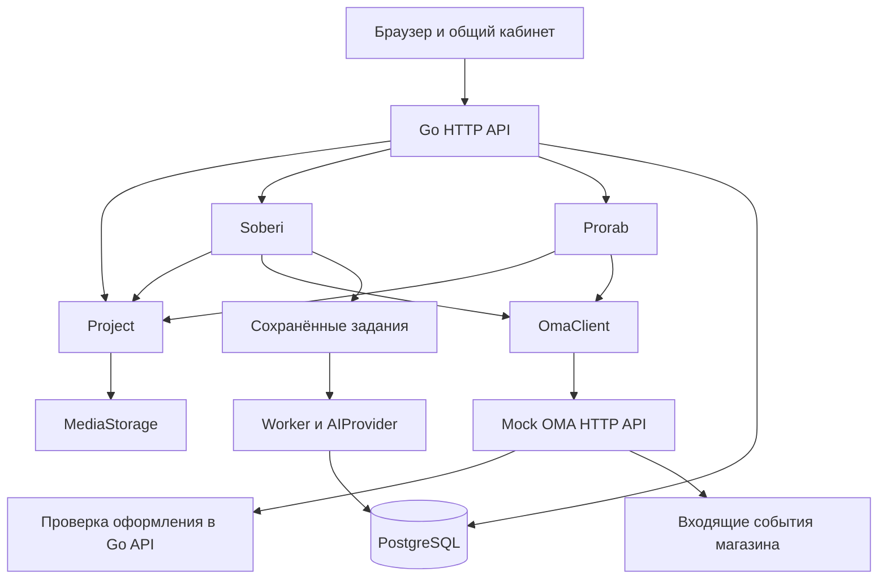

# Техническая спецификация ОМА Собери и ОМА Прораб

Версия 1.0 от 27 октября 2026 года. Приложение к [продуктовой спецификации](../OMA-product-spec.md).

Все компоненты, маршруты и структуры ниже являются проектируемыми контрактами. Они ещё не реализованы. Документ задаёт основу разработки на Go и не является инструкцией запуска готового приложения.

## Навигация

- [Архитектура](#architecture).
- [Общие данные](#data).
- [Состояния](#states).
- [Проверка и оплата](#checkout).
- [План отчёты и приёмка](#execution).
- [API](#api).
- [AI и визуализация](#visual).
- [Надёжность и доступ](#reliability).
- [Порядок реализации](#implementation).
- [Критерии проверки](#verification).

<a id="architecture"></a>
## 1 Архитектура

### 1.1 Компоненты

Рекомендуемая первая реализация — Go-приложение с выделенными модулями двух сервисов. Общая работа с проектом и транзакции находятся в одном сервере. Симулятор API ОМА запускается отдельным Go-процессом и имеет отдельное хранилище торговых данных.

| Компонент | Ответственность |
|---|---|
| Общий кабинет | Веб-страницы конструктора, магазина и исполнения, сессия пользователя и навигация |
| Project | Пользователи, помещения, медиа, доступ, инвентарь и версии проекта |
| Soberi | Запрос, варианты, изменения, спецификация и подготовка корзины |
| Prorab | Исполнители, проверки, назначения, планы, отчёты, решения и обращения |
| OmaClient | Адаптер HTTP API каталога, истории, корзин, оформления и доставки |
| AIProvider | Заменяемое подключение диалоговой и мультимодальной модели |
| Worker | Долгие задачи AI, подготовка медиа и доставка сохранённых событий |
| PostgreSQL | Доменные данные продукта, транзакции, задания и журнал событий |
| MediaStorage | Файлы через интерфейс хранения; локальный каталог в разработке, объектное хранилище при развёртывании |
| Mock OMA | Каталог, поиск, цены, доступность, история покупок, корзины, оплата-симуляция и доставка |

Сервисы имеют отдельные HTTP API и доменную ответственность; их можно позднее выделить в процессы без смены пользовательской модели. Во время первой реализации связь с магазином проходит через HTTP даже при локальном запуске, чтобы код не зависел от его внутренней базы.



### 1.2 Предлагаемая будущая структура

Это структура для последующего создания; перечисленные пакеты пока отсутствуют.

```text
cmd/app/                 общий Go-сервер
cmd/mockoma/             симулятор API магазина
cmd/worker/              обработка сохранённых заданий
internal/project/        проект, помещения, доступ, инвентарь
internal/soberi/         варианты и спецификация
internal/prorab/         выполнение и приёмка
internal/integrations/oma/ клиент API магазина
internal/ai/             контракты моделей и валидация результатов
internal/media/          файлы и управление доступом
internal/jobs/           задания и повторная обработка
internal/events/         журнал и доставка событий
internal/httpapi/        маршруты, сессия, ошибки
internal/store/          транзакции и репозитории
web/                     страницы и браузерные компоненты
migrations/              схема базы
fixtures/                демонстрационные товары и сценарии
```

Для HTTP достаточно стандартного `net/http`; выбор конкретных библиотек фиксируется при создании проекта. Поддержка маршрутов с методом и параметрами описана в [Go ServeMux](https://pkg.go.dev/net/http#ServeMux). Конкретные версии инструментов закрепляются при инициализации; этот документ не предписывает устаревшую версию Go.

<a id="data"></a>
## 2 Общие данные

### 2.1 Правила представления

- Денежные суммы — целые минимальные единицы и явная валюта BYN. Итоги считает сервер.
- Размеры — миллиметры; количество материалов — десятичные значения с единицами, без двоичной арифметики float для учётных сумм.
- Время — UTC в API; интерфейс проекта отображает Europe/Minsk.
- Каждый изменяемый агрегат имеет `version`; клиент передаёт ожидаемую версию.
- Снимки заказов, подтверждений, отчётов и решений сохраняются, а не перезаписываются.
- Для медиа хранятся автор, проект, время, тип, источник и политика видимости.
- Признак `demo` сопровождает синтетические профили, цены, заказы, доставки и подготовленные AI-ответы.

### 2.2 Планирование и покупка

| Сущность | Минимальное содержание |
|---|---|
| User | Идентификатор, роль и связь с торговой учётной записью |
| Project | Владелец, цель, бюджет, режим исполнения, участники, текущие подтверждённые версии |
| Room | Проект, название, геометрия, источник захвата и подтверждение размеров |
| Capture | Фото/план/скан, источник `manual`, `device_scan` или `demo_capture`, вопросы к геометрии |
| InventoryLot | Владелец, материал, количество, единица, состояние, источник, подтверждение и резерв |
| InventoryAllocation | Выделение партии на проект и комнату, состояние резервирования/расхода |
| DesignRevision | Запрос, ограничения, выбранные позиции, размещение, связанные медиа и предшествующая версия |
| SpecificationRevision | Геометрия и объём работ, потребности, имеющееся, упаковки, вопросы, версия правил расчёта |
| CartLink | Торговая корзина, владелец, проект, связанные строки и последняя синхронизация |
| ForemanReview | Исполнитель, область проверки, раунды снимков, вывод, правки, срок и технический отпечаток |
| CheckoutContext | Неизменяемая версия заказа для оформления, корзина, проверка, подтверждения, состояние и разрешение |
| OrderLink | Торговый заказ, исходный checkout, снимок, строки и доставка |

История покупок сначала порождает предложение подтвердить материал. `InventoryLot` со статусом `suggested` не участвует в уменьшении новой покупки. Для `confirmed` фиксируется подтверждённый объём; выделения защищают от двойного использования в активных проектах.

Спецификация отделяет количество для результата, необходимый резерв, выделенное имеющееся и новую покупку. Правила обоев, краски, покрытий и штучных товаров реализуются отдельно с тестируемыми вводными. Идентичные артикулы агрегируются для закупки с сохранением распределения по комнатам.

### 2.3 Исполнение

| Сущность | Минимальное содержание |
|---|---|
| ForemanProfile | Специальности, регион, доступность, состав команды, условия и статусы подтверждения |
| PortfolioCase | Участники, виды работ, разрешённые материалы и источник подтверждения |
| Engagement | Проект, выбранный исполнитель, согласованные объём, даты, команда и условия работ |
| WorkPlanRevision | Этапы, зависимости, материалы, критерии и согласованные веса приёмки |
| Stage | Комната/область работ, ответственные, сроки, состояние и текущий отчёт |
| StageReport | Версия, фотографии, выполненные пункты, пояснение и вопросы |
| StageDecision | Заказчик, точная версия отчёта, принятие либо замечания и время |
| ChangeRequest | Причина, патч объёма, материалы, влияние на цену/срок и согласия сторон |
| Dispute | Предмет, участники, сообщения, относящиеся версии, предложения и согласия |
| ProjectCompletion | Финальное подтверждение владельца и связанные принятые этапы |
| DomainEvent | Идентификатор, агрегат, версия, тип, автор и данные события |

Привязка к одному проекту обязательна для всех рабочих объектов. Участие в бригаде само по себе не открывает чужие проекты. Связанный с этапом мастер получает доступ к разрешённой части.

<a id="states"></a>
## 3 Состояния

| Объект | Состояния |
|---|---|
| AI-задача | `queued`, `running`, `succeeded`, `failed`, `cancelled` |
| Проверка | `queued`, `in_review`, `needs_info`, `needs_visit`, `changes_proposed`, `approved`, `declined`, `expired`, `superseded`, `cancelled` |
| Назначение | `candidate`, `proposed`, `agreed`, `active`, `completion_pending`, `completed`, `cancelled` |
| Этап | `planned`, `in_progress`, `submitted`, `changes_requested`, `accepted`, `paused`, `cancelled` |
| Изменение | `proposed`, `accepted`, `rejected`, `applied`, `cancelled` |
| Обращение | `open`, `collecting_context`, `proposal_sent`, `resolved`, `closed_unresolved` |
| Оформление | `draft`, `ready`, `authorized`, `paid`, `failed`, `expired`, `cancelled` |

Состояние заказа и доставки поступает из магазина: для симулятора задаются создание, ожидание оплаты, оплата, комплектация, частичная/полная доставка, отмена и состояния возврата. Новое состояние не выводится из нажатия клиентом кнопки.

Крупный статус проекта формируется по событиям и действующему плану; несогласованное изменение или обращение отображается отдельным признаком внимания. Завершение требует всех обязательных принятых этапов, урегулирования относящихся открытых вопросов и явного подтверждения владельца.

<a id="checkout"></a>
## 4 Проверка перед оплатой и согласованность заказа

### 4.1 Подготовка обращения

1. Клиент выбирает сценарий с прорабом и кандидата.
2. Preflight проверяет обязательные вводные, единицы и арифметику. Существенные пропуски возвращают `needs_data` со списком вопросов.
3. При готовности клиент отправляет запрос с идемпотентным ключом.
4. Создаётся одна активная карточка проверки по выбранной области и исполнителю. Снимки и последующие раунды внутри неё сохраняются отдельно.
5. Прораб получает сводку и конкретные неизвестные условия. Уведомление создаётся из события только один раз.

Генерации дизайна и обычный просмотр не вызывают этот процесс. Область проверки может включать одну комнату или согласованную группу работ; это позволяет не перепроверять несвязанные части квартиры.

### 4.2 Решение прораба

- `approve_current`: сохраняется профессиональное подтверждение текущего технического отпечатка.
- `propose_changes`: создаётся точная предложенная версия состава и подтверждение прораба именно для неё; состояние `changes_proposed`.
- `request_info` или `request_visit`: сохраняются конкретные вопросы/условия; подтверждения для оплаты пока нет.
- `decline`: сохраняется причина; клиент может выбрать другого кандидата.

Когда клиент принимает предложенные правки, система применяет именно эту версию и обновляет торговую корзину. Подтверждение становится действующим только после проверки совпадения итогового отпечатка с предложенным. Если появились другие существенные изменения, нужен новый раунд. Второе ручное одобрение неизменённого, уже подтверждённого предложения не требуется.

Профессиональная проверка означает подтверждение указанного состава при зафиксированных вводных. Назначение исполнителем и условия труда подтверждаются отдельным действием владельца.

### 4.3 Технический отпечаток

`review_input_hash` рассчитывается по каноническому представлению области работ, подтверждённой геометрии, характеристик и количеств проектных материалов, используемого имеющегося и существенных условий. Правила канонизации версионируются.

Цена, скидка, сортировка корзины и товары вне проекта не входят в этот отпечаток. Смена существенной характеристики/артикула, количества, размера или объёма делает соответствующее подтверждение неактуальным. Изменение даты отдельно требует проверки доступности и затронутых условий.

Истёкшее, отменённое или принадлежащее другому исполнителю подтверждение не используется. После оплаты снимок заказа не меняется; дальнейшие изменения идут отдельным дополнением и при необходимости новым заказом.

### 4.4 Протокол оформления

1. Магазин формирует неизменяемую котировку корзины с версией, суммой, сроком и проектными связями.
2. Backend создаёт `CheckoutContext` со снимком котировки, спецификацией, областью проверки и согласием клиента с суммой.
3. Непосредственно перед симуляцией оплаты сервер магазина вызывает защищённую серверную авторизацию оформления. Одной проверки в браузере недостаточно.
4. Backend проверяет владельца, котировку, режим исполнения, подтверждения, технический отпечаток и допустимость выделения имеющегося. Для самостоятельной работы профессиональное подтверждение не требуется.
5. В транзакции фиксируется разрешённый к оплате снимок и состояние `authorized`; повторный вызов с тем же ключом возвращает тот же результат.
6. Магазин проводит симуляцию по этой котировке и присылает событие результата с идентификатором заказа.
7. Backend идемпотентно создаёт связь с заказом и обновляет кабинет.

До авторизации изменение корзины или существенной подтверждённой версии требует нового оформления; старое разрешение не используется. После авторизации оплачиваемый состав заморожен. Дальнейшие запросы оформляются отдельно и не изменяют уже выполняющуюся оплату. Терминальный отказ закрывает оформление, а не переносит старое разрешение на другую сумму.

Между двумя базами нет общей транзакции. Связь восстанавливается по идемпотентным операциям, снимкам, журналу входящих событий и сверке с API заказа. Потерянное уведомление не должно создавать второй заказ или оставлять оплаченный заказ навсегда невидимым.

В промышленной интеграции ОМА должна поддержать серверную точку авторизации либо эквивалентный механизм подтверждения. В симуляторе этот контракт реализуется сразу.

### 4.5 Доставка и материалы

Заказанные и доставленные количества учитываются отдельно. Частичная поставка открывает готовность только тех работ, которым хватает необходимых материалов и выполнены остальные условия. Наличие своей партии подтверждается владельцем и фиксируется выделением.

Если покупок не требуется, назначение и работа могут начаться после согласования выполнения и готовности имеющегося. Пустая корзина не превращается в обязательный фиктивный заказ.

<a id="execution"></a>
## 5 План отчёты приёмка и изменения

План становится действующим после подтверждения владельца. Каждый этап имеет результат, зависимости, нужные материалы, критерии приёмки и вес. Цена работ отделена от оплаченных товаров.

| Действие | Кто | Условие и результат |
|---|---|---|
| Начать этап | Назначенный прораб | Согласованы работы, доступны условия; `in_progress` |
| Сдать отчёт | Назначенный прораб | Обязательные поля и медиа заполнены; `submitted` |
| Направить замечания | Владелец | Решение относится к конкретной версии отчёта; `changes_requested` |
| Исправить и сдать заново | Прораб | Новый отчёт сохраняет связь с предыдущим; `submitted` |
| Принять | Владелец | Явный флаг согласия и текущая версия отчёта; `accepted` |
| Изменить объём | Участник предлагает, обе стороны согласуют | Создаётся новая версия плана; история сохраняется |
| Завершить проект | Владелец | Обязательные этапы приняты, незакрытые препятствия отсутствуют |

Принятый этап не переписывается новым черновиком. Новая задача становится новым этапом или согласованным дополнением. Автоприёмка по таймеру отсутствует.

Прогресс приёмки: `100 × сумма весов accepted / сумма весов действующих обязательных этапов`. Сданный, но не принятый этап показывается отдельно. При согласованном расширении плана знаменатель может измениться; интерфейс объясняет новую базу и сохраняет исходный план для сравнения. Отменённый объём исключается только по согласованному изменению.

Отклонение от срока определяется по действующему согласованному графику и фактическим событиям. AI может описать событие, но не превращает фото в доказательство скрытого качества или независимого технадзора.

Обращение к ОМА содержит относящиеся версии и сообщения. Посредник запрашивает пояснения и предлагает решение. `resolved` требует явного согласия обеих сторон с конкретной версией предложения. Отказ не считается согласием. `closed_unresolved` сохраняет отсутствие согласования. Урегулирование не ставит `accepted`: приёмка выполняется владельцем отдельно.

## 6 Права участников

| Возможность | Заказчик | Прораб | Мастер | Посредник ОМА |
|---|---|---|---|---|
| Менять запрос/корзину | Свой проект | Предлагать правки | Нет | Нет |
| Подтвердить комплект | Принять правки | Назначенный проверяющий | Нет | Нет |
| Менять план | Согласовать | Предложить/согласовать | Предложить в разрешённой области | Предложить в рамках обращения |
| Публиковать рабочий отчёт | Нет | Да | Черновик в своей области; сдаёт прораб | Нет |
| Принять этап | Да | Нет | Нет | Нет |
| Открыть обращение | Да | Да | Через прораба | Обрабатывать |
| Видеть материалы спора | Свои | Свои | По отдельному разрешению | Только назначенное обращение |

Проверки выполняются сервером для каждого идентификатора, включая загрузку медиа и поток событий. Клиентские элементы управления не считаются механизмом доступа.

<a id="api"></a>
## 7 Проектируемый API

### 7.1 Общие соглашения

JSON; основной префикс `/api/v1`. Команды создания заказа, обращения, отчёта и решений принимают `Idempotency-Key`. Изменения существующего агрегата передают `expected_version`; несовпадение даёт `409 VERSION_CONFLICT`. Пагинация и ограничения размеров задаются явно при реализации.

Ошибки имеют поля `code`, `message`, `details`, `request_id`. Важные коды: `FORBIDDEN`, `NEEDS_DATA`, `REVIEW_REQUIRED`, `REVIEW_STALE`, `CART_CHANGED`, `QUOTE_EXPIRED`, `INVALID_TRANSITION`, `REPORT_CHANGED`, `VERSION_CONFLICT`, `INTEGRATION_UNAVAILABLE`.

### 7.2 Общие данные и Собери

| Метод и маршрут | Назначение |
|---|---|
| `POST /api/v1/demo/session` | Создать явно демонстрационную сессию выбранного тестового участника |
| `POST /api/v1/projects` | Создать проект |
| `GET /api/v1/projects/{project_id}` | Получить проект с доступными следующими действиями |
| `PATCH /api/v1/projects/{project_id}` | Обновить запрос и условия по версии |
| `POST /api/v1/projects/{project_id}/rooms` | Добавить помещение |
| `POST /api/v1/projects/{project_id}/captures` | Загрузить фото, план или результат захвата |
| `POST /api/v1/projects/{project_id}/inventory-suggestions` | Подготовить кандидатов из истории покупок |
| `POST /api/v1/projects/{project_id}/inventory` | Подтвердить имеющееся или добавить собственную партию |
| `POST /api/v1/projects/{project_id}/design-jobs` | Запустить подготовку вариантов или правки |
| `GET /api/v1/jobs/{job_id}` | Получить состояние и результат задания |
| `POST /api/v1/projects/{project_id}/design-selections` | Подтвердить выбранную версию |
| `POST /api/v1/projects/{project_id}/specifications` | Рассчитать спецификацию |
| `POST /api/v1/projects/{project_id}/cart-sync` | Создать/обновить связанные строки торговой корзины |
| `GET /api/v1/projects/{project_id}/events` | Получить разрешённый поток событий проекта |

### 7.3 Прораб и исполнение

| Метод и маршрут | Назначение |
|---|---|
| `GET /api/v1/foremen` | Получить кандидатов с причинами соответствия |
| `GET /api/v1/foremen/{foreman_id}` | Профиль, команда и разрешённые кейсы |
| `POST /api/v1/projects/{project_id}/purchase-preflight` | Проверить полноту подготовки к обращению |
| `POST /api/v1/projects/{project_id}/reviews` | Создать или вернуть существующий адресный запрос |
| `POST /api/v1/reviews/{review_id}/decisions` | Решение прораба с точными вводными/правками |
| `POST /api/v1/reviews/{review_id}/proposal-acceptance` | Принять точную предложенную версию |
| `POST /api/v1/projects/{project_id}/engagements` | Подготовить назначение и условия |
| `POST /api/v1/engagements/{engagement_id}/confirmation` | Подтвердить согласованные условия клиентом |
| `POST /api/v1/projects/{project_id}/work-plans` | Создать/изменить предложение плана |
| `POST /api/v1/work-plans/{plan_id}/confirmation` | Подтвердить план владельцем |
| `POST /api/v1/stages/{stage_id}/start` | Начать допустимый этап |
| `POST /api/v1/stages/{stage_id}/reports` | Опубликовать отчёт |
| `POST /api/v1/stages/{stage_id}/decisions` | Принять текущий отчёт либо направить замечания |
| `POST /api/v1/projects/{project_id}/changes` | Предложить изменение |
| `POST /api/v1/changes/{change_id}/decisions` | Согласовать или отклонить его |
| `POST /api/v1/projects/{project_id}/disputes` | Открыть обращение |
| `POST /api/v1/disputes/{dispute_id}/messages` | Добавить сообщение участника |
| `POST /api/v1/disputes/{dispute_id}/proposals` | Предложить урегулирование посредником |
| `POST /api/v1/disputes/{dispute_id}/decisions` | Принять/отклонить версию урегулирования |
| `POST /api/v1/projects/{project_id}/completion` | Завершить проект владельцем |

Просмотр списков планов, отчётов, изменений и обращений предоставляется соответствующими `GET`-ресурсами с той же проверкой участия. Контракты тел уточняются в OpenAPI при создании реализации; неподтверждённые клиентом поля не записываются как согласие.

### 7.4 API демонстрационного магазина

| Метод и маршрут | Назначение |
|---|---|
| `GET /oma-api/v1/products` | Поиск и фильтры |
| `GET /oma-api/v1/products/{sku}` | Параметры, изображения, 3D-ресурсы, цена и наличие |
| `GET /oma-api/v1/purchase-history` | История для авторизованной торговой учётной записи |
| `POST /oma-api/v1/carts` | Создать корзину с проектными связями |
| `GET /oma-api/v1/carts/{cart_id}` | Получить актуальный состав и версию |
| `PATCH /oma-api/v1/carts/{cart_id}` | Изменить строки по версии |
| `POST /oma-api/v1/carts/{cart_id}/quotes` | Заморозить котировку с суммой и сроком |
| `POST /oma-api/v1/checkout-sessions` | Создать оформление для котировки |
| `POST /oma-api/v1/checkout-sessions/{session_id}/pay` | Симулировать оплату после серверной авторизации |
| `GET /oma-api/v1/orders/{order_id}` | Заказ и распределение поставок |
| `POST /oma-api/v1/demo/orders/{order_id}/events` | Управлять доставкой и сбоями демо; оплата проходит только через оформление |

Магазин вызывает `POST /internal/v1/oma/checkout-authorizations` и `POST /internal/v1/oma/events` в основном backend. Эти маршруты доступны только сервисному клиенту. Уведомления содержат идентификатор события, вид и идентификатор агрегата (корзина, заказ или поставка), тип, версию, корреляцию и снимок относящихся данных. Повторный идентификатор обрабатывается один раз.

Корзина имеет отдельные `project_id`, `specification_revision_id` и идентификатор связи каждой проектной строки. При синхронизации меняются только принадлежащие этому проекту строки; повторное действие обновляет их, а не добавляет заново.

Правка проектной строки через поиск магазина порождает `cart.updated`. Backend сохраняет торговую версию, проверяет изменение и готовит связанную версию спецификации/визуального состава. Конфликт с закреплённым условием показывается клиенту. Пока существенная правка не согласована и не проверена, прежнее подтверждение не разрешает новый состав. Собственные события синхронизации распознаются по корреляции и не запускают бесконечный обмен правками. Изменение только цены обновляет торговую оценку без смены технического состава.

### 7.5 Пример команды приёмки

Проектируемое тело для `POST /api/v1/stages/{stage_id}/decisions`:

```json
{
  "expected_version": 7,
  "report_id": "report_demo_02",
  "decision": "accept",
  "acceptance_confirmed": true,
  "comment": "Замечания устранены, этап принимаю"
}
```

Сервер проверяет роль владельца, текущую версию отчёта, допустимость решения и отсутствие блокирующего активного обращения по этому предмету. Ложное или отсутствующее подтверждение не принимает этап. Повтор с тем же ключом не создаёт второе решение.

<a id="visual"></a>
## 8 AI визуализация и сканирование

AI возвращает структурированный черновик: предложенные позиции из переданного разрешённого каталога, размещение, изменения, вопросы и объяснение. Ответ проверяется схемой и доменными правилами. Выход за бюджет, неизвестный артикул или снятие закреплённого ограничения возвращаются на уточнение, а не записываются молча.

Для каждой задачи сохраняются входная версия, режим `live`/`demo`, результат проверки и разрешённые выходные данные. Вызовы выполняет worker из сохранённой очереди. Превышение времени, отказ провайдера и неподходящий ответ имеют явное состояние; прежний подтверждённый проект остаётся доступен.

Фото-эскиз, геометрия и список товаров хранятся отдельно и связаны версией. Спецификация вычисляется из геометрии и структурированного состава, а не из свободно сгенерированной картинки.

Для комнаты/квартиры поддерживается последовательный ввод помещений и импорт захвата через `RoomCaptureProvider`. Реальный способ зависит от устройства. [RoomPlan](https://developer.apple.com/augmented-reality/roomplan/) использует камеру и LiDAR; ручной ввод и фото остаются самостоятельными рабочими способами. Подготовленный захват маркируется `demo_capture`.

Для отдельных моделей подходит [model-viewer](https://modelviewer.dev/examples/augmentedreality/) с WebXR, Scene Viewer или Quick Look. WebXR требует подходящего защищённого контекста; доступность проверяется на устройстве. UI внутри WebXR и нативного просмотра имеет разные возможности. Геометрия модели соответствует каталогу, свободное изменение масштаба при примерке товара отключено. Визуализация целой отделки и размещение одного объекта — отдельные режимы.

Сцена сохраняется перед переходом в AR. Возврат открывает ту же версию. Переход с компьютера на телефон связывается с сессией владельца; QR не публикует фотографии квартиры для посторонних. Цвет и фактура при необходимости подтверждаются физическим образцом.

<a id="reliability"></a>
## 9 Надёжность доступ и восстановление

Транзакция сохраняет доменную команду, новую версию и исходящее событие вместе. Обработчик событий повторяет недоставленное и фиксирует результат. Для входящих событий уникальный идентификатор защищает от повторного эффекта. Гарантия касается идемпотентности применения, а не недостижимого обещания однократной сетевой доставки. Базовая атомарность транзакций описана в [PostgreSQL](https://www.postgresql.org/docs/current/tutorial-transactions.html).

Обновления кабинета передаются через один авторизованный SSE-поток проекта с идентификаторами событий и восстановлением после разрыва. При необходимости клиент перечитывает актуальный снимок. Команды идут отдельными HTTP-запросами. Формат и `Last-Event-ID` определены в [HTML Standard](https://html.spec.whatwg.org/dev/server-sent-events.html).

Загрузка медиа ограничивается разрешёнными типами и размером; файлы доступны по проверяемой связи с проектом. Фотографии и документы передаются модели только в нужном объёме. Содержимое загруженного документа рассматривается как данные, а не как инструкция системе.

Демонстрационная смена ролей работает только при `DEMO_MODE`; в обычном развёртывании требуется нормальная сессия и соответствующее подключение учётных записей. Секреты AI и сервисной интеграции хранятся на сервере и не передаются браузеру.

При недоступности магазина остаётся сохранённый проект, но наличие и оплата не выдаются за подтверждённые. При недоступности AI доступны прежние версии. При устаревшем подтверждении клиент видит адресное действие, а не теряет весь проект.

Предлагаемые настройки: `DATABASE_URL`, `OMA_API_BASE_URL`, `OMA_SERVICE_SECRET`, `MEDIA_STORAGE_PATH`, `AI_MODE`, `AI_API_KEY`, `DEMO_MODE`, `REVIEW_VALIDITY`, `CHECKOUT_VALIDITY`. Имена являются частью будущего контракта; значения и точные ограничения фиксируются при реализации.

<a id="implementation"></a>
## 10 Порядок реализации

| Этап | Результат и зависимость |
|---|---|
| A Основа | Go-сервер, PostgreSQL, миграции, роли, проект, комнаты, версии и файлы |
| B Магазин | Отдельный Mock OMA, каталог, поиск, корзина, котировка, оплата и доставка; клиент адаптера |
| C Данные подбора | Инвентарь, подтверждение истории, правила расчёта и версии спецификаций |
| D Выбор и визуализация | AI-провайдер, задания, варианты, правки, фото/3D и проверенная AR-примерка |
| E Связь с покупкой | Идемпотентная синхронизация корзины и возврат магазинных изменений в проект |
| F Прораб до оплаты | Профили, preflight, карточка проверки, предложения правок, действительность подтверждения |
| G Оформление | Неизменяемая котировка, серверная авторизация, события и восстановление заказа |
| H Выполнение | Назначение, план, готовность материалов, отчёты, замечания и приёмка |
| I Посредничество | Обращения, предложения, согласия и закрытие с сохранением исхода |
| J Целостный кабинет | Прогресс по приёмке, визуальный ориентир, SSE, история и фактические остатки |
| K Проверка | Доменные тесты, контракт симулятора и основные пользовательские сценарии |

Задачи выполняются по зависимостям, без выдуманного ограничения числа дней. До начала активной разработки необходимо согласовать только реальные доступы и устройства, когда они потребуются; отсутствие API ОМА уже закрыто симулятором. Внешний AI-провайдер и способ захвата заменяемы.

<a id="verification"></a>
## 11 Критерии проверки

Это перечень будущей проверки реализации; программные тесты в рамках подготовки документа не запускались.

| Проверка | Ожидаемое поведение |
|---|---|
| Квартира с двумя помещениями | Один проект, общая закупка и сохранённое распределение |
| История без подтверждения остатка | Новая покупка не уменьшается |
| Один остаток в двух проектах | Нельзя выделить объём сверх доступного |
| Повтор cart-sync | Нет удвоения строк; посторонние строки сохраняются |
| Изменение только цены | Новая сумма требует согласия, техническая проверка не повторяется |
| Существенная замена материала | Старое подтверждение не разрешает новое оформление |
| Точные предложенные правки | Принятие активирует подтверждение только для совпавшего итогового состава |
| Повтор запроса проверки | Одна карточка и одно соответствующее уведомление |
| Подмена чужого review/cart/project | Сервер отклоняет обращение |
| Старая котировка или изменённая корзина | Оплата не проходит по устаревшему основанию |
| Повтор события оплаты | Одна связь с заказом, без повторного эффекта |
| Утерянное событие магазина | Сверка восстанавливает оплаченный заказ |
| Частичная доставка | Готовность ограничена обеспеченными этапами |
| Работа только с собственными материалами | Старт возможен без фиктивной покупки |
| Отчёт прораба | Состояние «На приёмке», принятый процент не растёт |
| Замечание и новый отчёт | Старые версии сохраняются; приёмка относится к новой версии |
| Прораб/оператор пытается принять | Действие отклоняется |
| Посредник предлагает решение | Приёмка не происходит автоматически |
| Один участник не принял урегулирование | Нет состояния `resolved` |
| План расширен по согласованию | Прогресс пересчитан с объяснением новой базы |
| Изменение после оплаты | Старый заказ и его позиции остаются неизменными |
| Разрыв SSE/обновление страницы | Актуальные состояния восстанавливаются из сервера |
| Неподходящий AI-ответ | Нет автоматической записи неизвестных позиций или снятия ограничений |
| AR недоступен | Сохраняется проект и доступен рабочий резервный режим |
| Финальное завершение | Требуются обязательные принятые этапы и подтверждение владельца |

Основное сквозное испытание проходит роли клиента, прораба и посредника через один проект. Отдельно проверяются самостоятельная работа, существующие материалы, изменения перед оплатой и повторные события интеграции.
